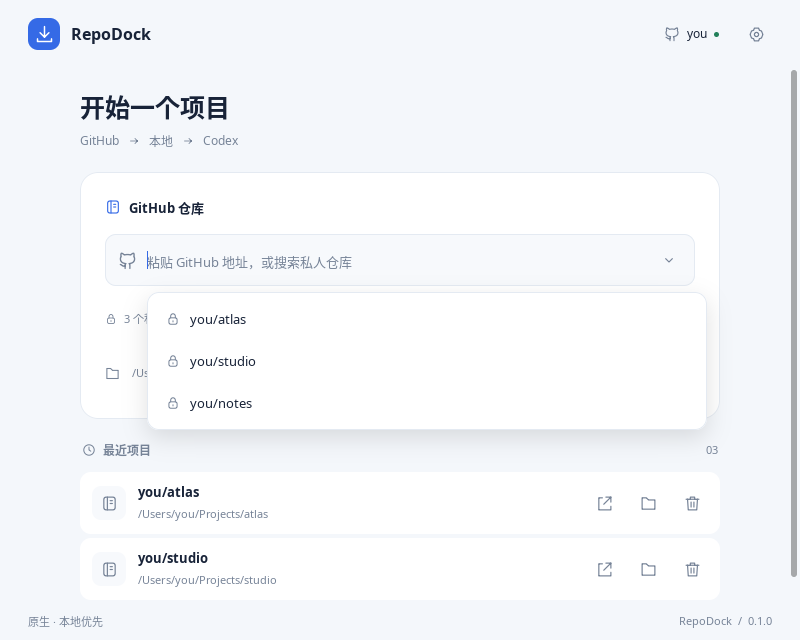
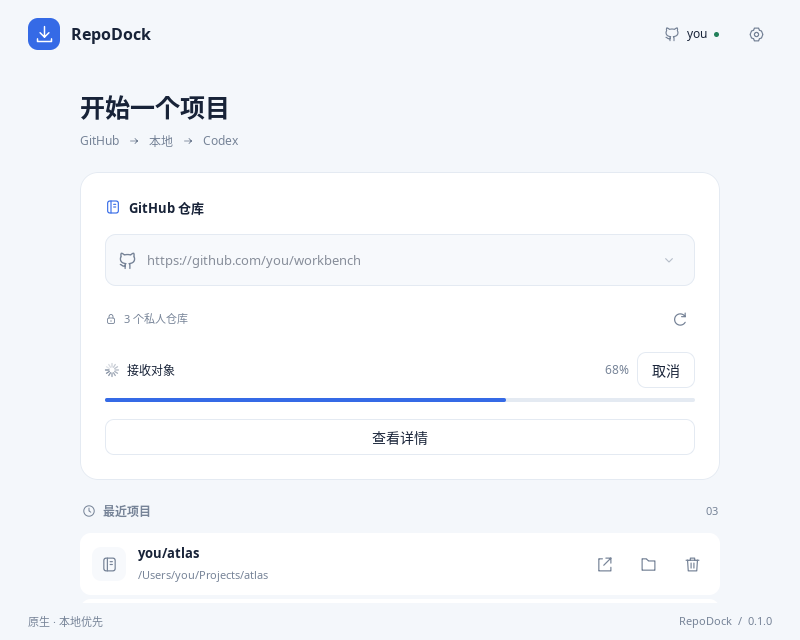
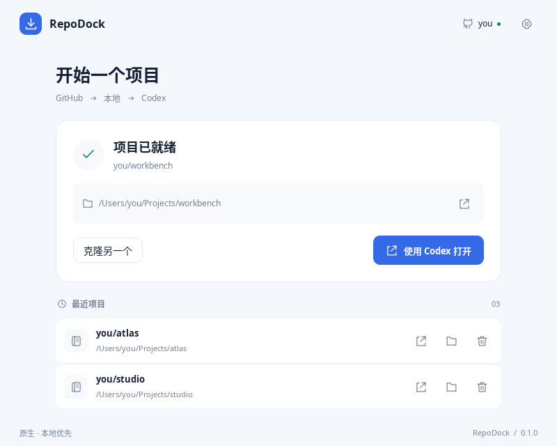
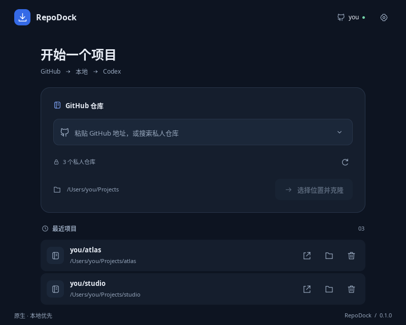

<h1 align="center">
  <picture>
    <source media="(prefers-color-scheme: dark)" srcset="docs/assets/readme-brand-dark.svg">
    
  </picture>
</h1>

<p align="center"><strong>基于 Go 与 <a href="https://github.com/egoist/mygo">MyGO</a> 构建的原生 GitHub 项目启动器。</strong></p>

<p align="center">
  <a href="#下载与构建"><strong>下载与构建</strong></a> &nbsp;·&nbsp;
  <a href="#功能">功能</a> &nbsp;·&nbsp;
  <a href="#界面导览">界面导览</a> &nbsp;·&nbsp;
  <a href="#快速开始">快速开始</a> &nbsp;·&nbsp;
  <a href="#开源协议">开源协议</a>
</p>

<p align="center">RepoDock 是一款小巧的 GitHub 项目启动器，使用 Go 编写，基于 MyGO 构建原生桌面界面，无需 WebView、Electron 或 JVM。<br>
ZIP 压缩包约 4 MB，支持 Windows 与 macOS，将选择仓库、克隆到本机和打开 Codex 串成一个简单流程。</p>

看到一个想研究的项目，或准备继续自己的私人仓库时，只需选好仓库和保存位置。RepoDock 会准备好本地代码，完成后即可一键在 Codex 桌面应用中打开项目目录。

> 当前版本为 **0.1.0**。已通过自动测试与三平台构建；Windows / macOS 上真实私人仓库与 Codex 的联动仍需[实机验收](docs/ACCEPTANCE.md)。

## 功能

- **仓库地址输入**：粘贴 GitHub HTTPS 或 SSH 地址，克隆当前账户可访问的项目。
- **私人仓库选择**：复用本机 GitHub CLI 登录，自动读取本人拥有的私人仓库，支持搜索、分页和键盘选择。
- **原生目录选择**：使用系统文件夹选择器指定保存位置，并记住上次使用的目录。
- **克隆进度与取消**：查看当前阶段和进度，按需展开详细日志，支持取消和失败后重试。
- **一键打开 Codex**：克隆完成后，在 Codex 桌面应用中新建使用该项目目录的聊天。
- **最近项目**：在本机保留最多 20 条记录，直接打开 Codex、打开文件夹或移除记录；失效路径会显示为不可用。
- **简洁原生界面**：单页窗口，支持跟随系统、浅色和深色主题，账户与工具设置集中在右上角。

## 界面导览

<table>
  <tr>
    <td width="50%" valign="top"><strong>选择仓库</strong><br>
      粘贴 GitHub 地址，或搜索账户名下的私人仓库。<br><br>
      <a href="docs/assets/readme-repositories.png"></a></td>
    <td width="50%" valign="top"><strong>查看克隆进度</strong><br>
      在同一张卡片中查看阶段进度、取消操作和详细日志。<br><br>
      <a href="docs/assets/readme-progress.png"></a></td>
  </tr>
  <tr>
    <td valign="top"><strong>项目就绪</strong><br>
      确认项目保存位置，再一键使用 Codex 打开。<br><br>
      <a href="docs/assets/readme-ready.png"></a></td>
    <td valign="top"><strong>深色主题与最近项目</strong><br>
      保留常用项目入口，让界面跟随你的工作习惯。<br><br>
      <a href="docs/assets/readme-dark.png"></a></td>
  </tr>
</table>

<sub>界面图片由 MyGO 离线内存渲染生成，使用示例账户、仓库和路径，用于展示实际界面布局。应用界面目前为中文。</sub>

## 快速开始

### 下载与构建

本地构建产物位于 `dist/`；通过仓库中的 [GitHub Actions 工作流](.github/workflows/build.yml)构建时，可从对应运行的 Artifacts 中获取平台压缩包。也可以按照[开发与构建说明](docs/DEVELOPMENT.md)自行构建。

| 平台 | 压缩包 |
| --- | --- |
| Windows x64 | `RepoDock-0.1.0-windows-amd64.zip` |
| macOS Apple Silicon（arm64） | `RepoDock-0.1.0-macos-arm64.zip` |
| macOS Intel（amd64） | `RepoDock-0.1.0-macos-amd64.zip` |

Windows 完整解压后运行 `RepoDock.exe`；macOS 将 `RepoDock.app` 放入“应用程序”。运行应用无需安装 Go；压缩包包含第三方许可，构建目录中的 `SHA256SUMS.txt` 可用于校验文件完整性。

当前本地交叉构建产物未完成 Windows 代码签名、Apple Developer ID 签名或公证。macOS 可能拦截首次启动；核实文件来源后，可通过系统“隐私与安全性”设置允许打开。当前提供上述三种平台包。

### 首次配置

1. **安装本机工具**：准备 [Git](https://git-scm.com/downloads)、[GitHub CLI](https://cli.github.com/) 和 [Codex 桌面应用](https://chatgpt.com/codex)。
2. **连接 GitHub**：如果本机 `gh` 已登录，可直接复用；首次使用时在终端执行下方命令，按提示完成浏览器登录。
3. **确认工具状态**：启动 RepoDock，打开右上角设置，查看 Git、GitHub CLI 和 Codex 的检测结果。Git / gh 路径可自动查找，也可手动填写完整绝对路径，再点击“保存并检测”。

```sh
gh auth login --hostname github.com --web
```

安装工具后，若应用尚未识别新的 PATH，可退出并重新打开 RepoDock。

### 从 GitHub 到 Codex

1. **选择仓库**：粘贴 GitHub 仓库地址，或展开下拉列表，输入名称搜索私人仓库。方向键定位，`Enter` 选择。
2. **选择保存位置**：点击“选择位置并克隆”，在系统对话框中选择父文件夹。项目会保存到其中的仓库同名子目录，例如 `Projects/atlas`。
3. **等待克隆完成**：卡片会显示当前阶段与进度，可随时取消，或展开“查看详情”阅读日志。
4. **打开项目**：出现“项目已就绪”后，点击“使用 Codex 打开”。以后也可以直接从“最近项目”进入。

已有同名目录时，应用会提示重新选择位置。克隆会先写入本次临时目录，通过仓库验证后再保存为最终项目目录；取消、失败和正常退出时会先结束子进程，再尝试清理本次临时目录，清理失败会保留错误提示。

### 查找和继续最近项目

- 最近项目保存在本机，最多保留 20 条；在 Codex 中再次打开后，记录会排到前面。
- 每条记录提供 Codex、文件夹和移除入口。移除记录只影响列表，本地代码仍保留。
- 项目目录被移动或删除后，记录显示“目录不可用”，打开按钮暂时禁用。

## 集成

| 集成 | 用途 | 接入条件 |
| --- | --- | --- |
| Git | 完整克隆远程默认分支、验证本地仓库 | 本机安装 Git |
| GitHub CLI | 识别账户、分页读取私人仓库、复用克隆凭据 | 本机安装 `gh` 并登录 GitHub.com |
| Codex 桌面应用 | 新建使用项目目录的聊天 | 安装应用并注册 Codex 系统协议 |
| 系统文件管理器 | 选择保存位置、打开本地项目目录 | 使用系统原生对话框与打开动作 |

私人仓库列表只包含当前 `gh` 凭据有权访问的、本人拥有的私人仓库；组织和协作仓库可通过手动输入地址访问。列表按更新时间排序，超过 100 个仓库时继续分页读取；分页中断会保留已加载部分并提示重试。切换 `gh` 账户后，可点击刷新或重新聚焦窗口更新列表。

如授权范围不足，可先在终端执行 `gh api user` 检查登录身份；需要时运行 `gh auth refresh --hostname github.com --scopes repo` 更新授权，再回到应用刷新。

RepoDock 负责准备本地代码与提供打开入口。项目的依赖安装、运行环境，以及 Codex 中的后续开发由对应工具和项目管理。

## 本地数据

| 平台 | 设置文件 |
| --- | --- |
| Windows | `%APPDATA%\RepoDock\state.json` |
| macOS | `~/Library/Application Support/RepoDock/state.json` |

设置文件保存主题、工具路径、上次保存位置和最近项目，采用原子写入。GitHub 凭据交由本机 `gh` 管理，RepoDock 不保存或导出账户令牌。RepoDock 的配置和克隆结果保存在本机目录。

## 开发

使用 **Go 1.27.1** 与 **MyGO v0.5.5**，依赖由 `go.mod` / `go.sum` 固定。安装 Go 后即可测试和启动：

```sh
go test ./...
go run ./cmd/repodock
```

原生热重载、离线界面预览、配置隔离及三平台打包，见[开发与构建说明](docs/DEVELOPMENT.md)。

## 文档

| 文档 | 内容 |
| --- | --- |
| [项目交接](HANDOFF.md) | 产品约束、架构入口、关键流程、验证边界与后续工作 |
| [开发与构建](docs/DEVELOPMENT.md) | 本地启动、测试、界面预览、架构与打包 |
| [发布验收](docs/ACCEPTANCE.md) | 自动验证范围与 Windows / macOS 实机验收步骤 |
| [第三方许可说明](THIRD-PARTY-NOTICES.txt) | 依赖版本、开源许可及来源 |

## 开源协议

RepoDock 使用 [MIT License](LICENSE)。第三方依赖保留各自的许可证和版权声明。

界面与产品文档参考 [Silverwing](https://github.com/javatoai/silverwing)，原生桌面框架由 [MyGO](https://github.com/egoist/mygo) 提供。
