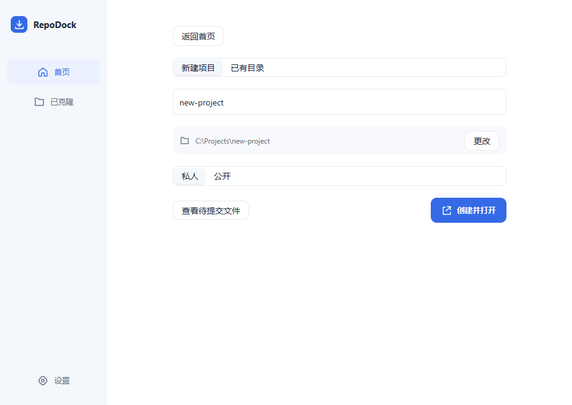
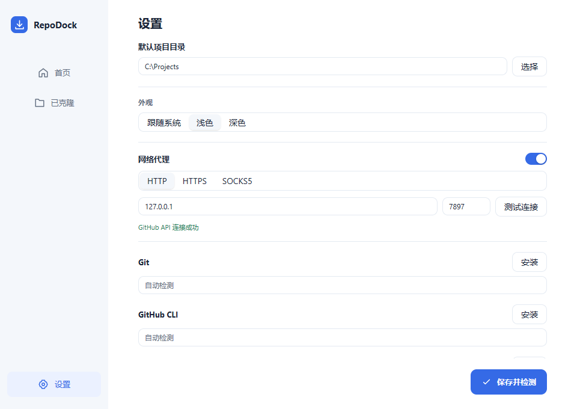

<h1 align="center">
  <picture>
    <source media="(prefers-color-scheme: dark)" srcset="docs/assets/readme-brand-dark.svg">
    
  </picture>
</h1>

<p align="center"><strong>基于 Go 与 <a href="https://github.com/egoist/mygo">MyGO</a> 构建的原生 GitHub 项目启动器。</strong></p>

<p align="center">
  <a href="#功能">功能</a> &nbsp;·&nbsp;
  <a href="#界面导览">界面导览</a> &nbsp;·&nbsp;
  <a href="#快速开始"><strong>快速开始</strong></a> &nbsp;·&nbsp;
  <a href="#文档">文档</a> &nbsp;·&nbsp;
  <a href="#开源协议">开源协议</a>
</p>

<p align="center">
  <picture>
    <source media="(prefers-color-scheme: dark)" srcset="docs/assets/readme-dark.png">
    
  </picture>
</p>

<p align="center">搜索 GitHub 上的公开、私人仓库，克隆到本地，再用 Codex 打开。<br>
也可以新建项目或发布已有目录，从同一个入口继续本地开发。</p>

RepoDock 将查找仓库、准备目录和打开项目连在一起。首页负责搜索与创建，“已克隆”保留准备好的本地项目；原生界面支持 Windows 与 macOS，提供浅色、深色及跟随系统的外观。

## 功能

- **GitHub 搜索**：读取本人拥有的公开、私人仓库，按最近更新时间排序，支持名称过滤和粘贴仓库地址。
- **克隆与目录保护**：设置默认项目目录，按项目单独更改位置；目标已存在时禁用克隆，提供资源管理器入口。
- **本地项目列表**：克隆或发布成功即可进入“已克隆”，无需先打开 Codex；按准备完成时间排序，支持搜索、定位和移除记录。
- **创建与发布**：新建项目并初始化 README，或发布没有远程配置的已有目录；默认私人仓库，可切换为公开。
- **Codex 打开**：从本地项目列表打开工作目录，GitHub 离线或 gh 不可用时仍可继续已有项目。
- **网络代理**：支持 HTTP、HTTPS、SOCKS5，统一用于 gh 与 Git 的网络操作，可在设置中测试连接。
- **原生设置**：默认目录、外观、工具和账户在主内容区平铺展示，页面切换保留当前会话的未保存输入。

## 界面导览

<table>
  <tr>
    <td width="50%" valign="top"><strong>搜索 GitHub 项目</strong><br>
      查看最近更新的仓库，输入名称或直接粘贴地址。<br><br>
      <a href="docs/assets/readme-repositories.png"></a></td>
    <td width="50%" valign="top"><strong>已克隆项目</strong><br>
      找到准备好的本地项目，直接用 Codex 打开。<br><br>
      <a href="docs/assets/readme-ready.png"></a></td>
  </tr>
  <tr>
    <td valign="top"><strong>创建与发布</strong><br>
      新建项目或选择已有目录，提交并发布到 GitHub。<br><br>
      <a href="docs/assets/readme-create.png"></a></td>
    <td valign="top"><strong>网络代理</strong><br>
      选择代理协议、填写地址，在保存前测试连接。<br><br>
      <a href="docs/assets/readme-proxy.png"></a></td>
  </tr>
</table>

<sub>截图来自 MyGO 离线渲染，使用示例账户、仓库和路径；应用界面目前为中文。</sub>

## 快速开始

### 准备工具

RepoDock 复用本机工具与 GitHub 账户：

| 工具 | 用途 |
| --- | --- |
| [Git](https://git-scm.com/downloads) | 克隆、提交、推送和远程提交核对 |
| [GitHub CLI（gh）](https://cli.github.com/) | GitHub 登录、仓库查询与创建 |
| [Codex 桌面应用](https://chatgpt.com/codex) | 打开准备好的项目目录 |

在终端连接 GitHub：

```sh
gh auth login --hostname github.com --web
```

GitHub 凭据由本机 gh 管理，RepoDock 不保存 GitHub 令牌。即使已配置 Git SSH 密钥，读取私人仓库列表和创建仓库仍需要 gh 登录。

### 从源码启动

项目使用 Go 1.27.1 与 MyGO v0.5.5，依赖版本由 `go.mod` 和 `go.sum` 固定。

```sh
git clone https://github.com/javatoai/repodock.git
cd repodock
go run ./cmd/repodock
```

Windows 图形程序构建、macOS 打包及独立开发配置见[开发文档](docs/DEVELOPMENT.md)。

### 搜索并打开项目

1. **设置目录与工具**：点击左下角“设置”，确认 Git、gh 和账户状态，选择默认项目目录。
2. **搜索仓库**：回到首页，聚焦搜索框查看本人名下的仓库，输入名称过滤，也可粘贴 HTTPS 或 SSH 地址。
3. **克隆到本地**：选中项目，确认保存位置后点击“克隆项目”。本次更改位置不会修改默认目录。
4. **用 Codex 打开**：克隆完成后点击打开按钮，之后可以从“已克隆”继续该项目。

再次搜索已记录的项目，会跳转到“已克隆”并定位对应记录，不重复克隆。列表只管理 RepoDock 已记录的项目，不扫描电脑中的其他仓库；组织或协作仓库可通过地址克隆。

克隆只检查“父目录／仓库名”这个实际目标，父目录中的其他项目不影响操作。目标已存在（包括空目录）、为文件或无法检查时，克隆按钮会禁用；可以更改位置，或点击“打开目录”查看。SSH 地址会转换为 GitHub HTTPS 地址，通过 gh 完成克隆认证。

### 创建或发布项目

在首页点击“创建项目”：

- **新建项目**：填写项目名与父目录，初始化 `main` 分支和 README。
- **发布已有目录**：选择项目根目录，保留已有 Git 历史、分支和 `.gitignore`；尚无 Git 仓库时进行初始化。

仓库默认私人，可以切换为公开，也可以展开查看待提交文件。点击“创建并打开”后，RepoDock 会提交项目改动、创建 GitHub 仓库、推送并核对远程提交，随后请求 Codex 打开项目。

发布前需要有效的 Git 提交姓名与邮箱；已有目录须未配置远程仓库。已有远程或 GitHub 上有同名仓库时会提前停止。发布失败会保留本地内容和已创建的远端，继续任务时复用已完成步骤；如果只有 Codex 打开失败，只重试打开。

### 使用网络代理

在“设置 → 网络代理”中启用，默认关闭，预填 `HTTP / 127.0.0.1 / 7897`，支持 HTTP、HTTPS 和 SOCKS5。

“测试连接”使用当前草稿请求 GitHub API；保存后刷新账户状态。启用后，仓库查询、创建、克隆、推送和远程核对使用指定代理，失败时不会自动切换直连。关闭时沿用原有网络环境，不修改系统代理或全局 Git 配置。

## 本地数据

配置、项目记录和未完成的发布进度保存在本机：

| 平台 | 默认配置路径 |
| --- | --- |
| Windows | `%APPDATA%\RepoDock\state.json` |
| macOS | `~/Library/Application Support/RepoDock/state.json` |

“已克隆”菜单中的移除操作只清理项目记录和关联历史，保留本地文件与 GitHub 仓库。目录移动或删除后会显示不可用；Codex 打开成功表示系统已接收协议请求，实际项目是否打开可在 Codex 中确认。

## 开发

```sh
go test ./...
go vet ./...
go run ./cmd/repodock --config-dir ./artifacts/dev-config
go run ./cmd/preview -out ./artifacts/preview
```

预览命令生成首页、项目列表、创建、目录冲突、设置与代理等浅深主题和窄窗口截图。自动测试使用临时 Git 仓库、本地代理服务与命令替身，不创建真实 GitHub 仓库，也不启动 Codex。

## 文档

| 文档 | 内容 |
| --- | --- |
| [开发与构建](docs/DEVELOPMENT.md) | 本地启动、界面预览、接口、持久化与平台打包 |
| [项目交接](HANDOFF.md) | 当前实现、架构入口、兼容规则与验证记录 |
| [验收清单](docs/ACCEPTANCE.md) | 自动测试覆盖、实机验证步骤与平台验证边界 |

## 开源协议

RepoDock 使用 [MIT License](LICENSE)。第三方依赖的许可证和版权声明见 [THIRD-PARTY-NOTICES.txt](THIRD-PARTY-NOTICES.txt)。
